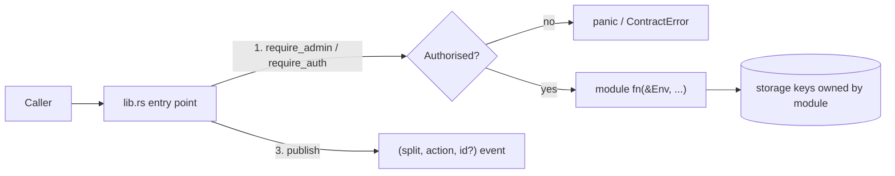
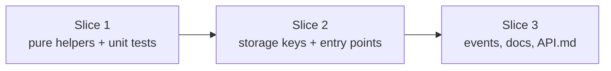
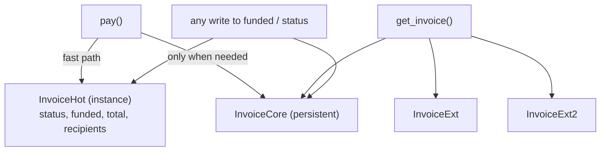
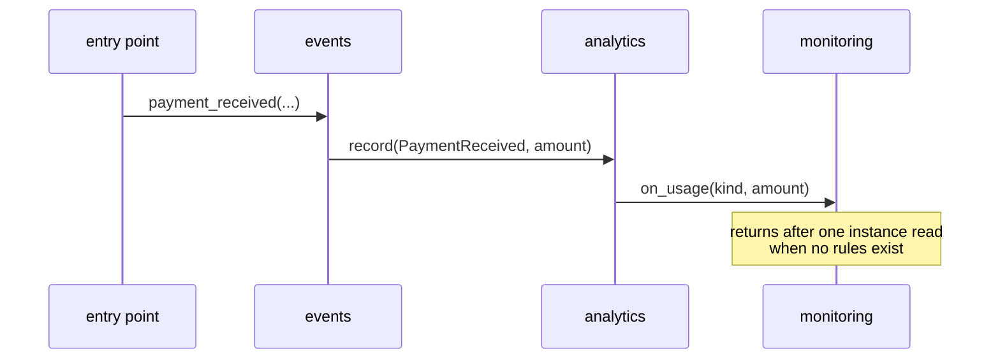
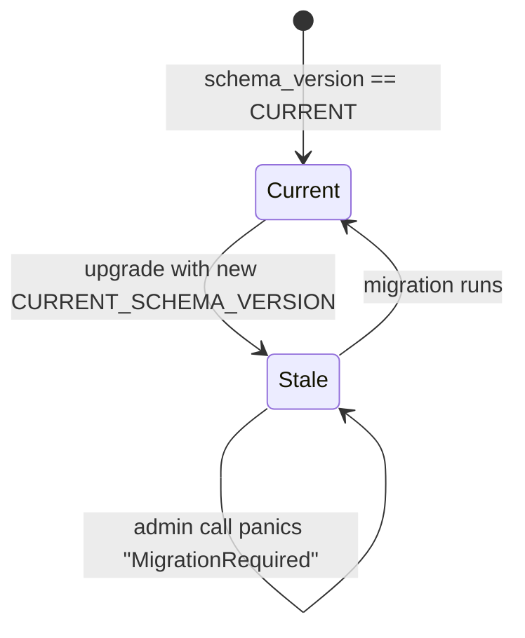

# Advanced Contract Architecture

Patterns the `split` contract uses again and again, with diagrams, code taken from the repository,
an optimization guide and a quick reference. Read [`ARCHITECTURE.md`](./ARCHITECTURE.md) first: it
describes the system map, storage model and state flows that this page builds on.

- [1. Patterns](#1-patterns)
- [2. Examples](#2-examples)
- [3. Optimization guide](#3-optimization-guide)
- [4. Reference](#4-reference)

Diagrams use [Mermaid](https://mermaid.js.org/), which GitHub renders inline.

---

## 1. Patterns

### 1.1 Thin entry point, self-contained module

Every public function lives in `lib.rs` and does three things: check authorisation, call into a
module, and emit an event. The module takes `&Env`, owns its storage keys and never checks auth
([ADR 0002](./adr/0002-single-contract-with-modules.md)).



Use it when the logic has its own state or can be unit-tested without the rest of the contract.

### 1.2 Pure first slice

New features often land as a module of pure functions and plain structs with no storage and no
entry points (for example `tiered_access`, `invoice_watermark`, `perf_profiling`). The module is
declared in `lib.rs` so it compiles and its `#[cfg(test)]` tests run, and a later change wires it
to storage and entry points.



Use it to agree on the rules of a feature before paying for storage layout and WASM size.

### 1.3 Split record with a hot-path cache

An invoice is spread over several keys so no entry grows past Soroban's size limit, and the four
fields `pay()` needs are cached in `InvoiceHot` in instance storage
([ADR 0004](./adr/0004-split-invoice-records.md)).



Rule: every write that changes a cached field writes the cache too, in the same call.

### 1.4 Event-fed observability

Lifecycle event helpers in `events.rs` also record usage in `analytics`, and `analytics` hands each
event to `monitoring` ([ADR 0003](./adr/0003-observability-from-event-helpers.md)). Entry points
never call analytics directly, so a new lifecycle event is counted as soon as it uses a helper.



### 1.5 Non-reverting side effects

Work that must never fail the caller (alert delivery, counters) is written so it cannot panic:
external calls use `try_invoke_contract` and counters saturate
([ADR 0005](./adr/0005-alert-delivery.md)).

### 1.6 Bounded collections

Any list that an entry point loops over has a cap constant (`MAX_ALERT_RULES`,
`MAX_PROFILED_OPERATIONS`, `MAX_SPLIT_RULES`, …). The cap is checked on insert, so the loop cost is
known when the budget is set.

### 1.7 Schema-gated admin path

`require_admin` calls `migrations::require_schema_current` before checking auth, so no admin action
runs against storage written by an older schema until the migration has run.



---

## 2. Examples

### 2.1 Authorisation then schema check (`lib.rs`)

```rust
fn require_admin(env: &Env) -> Address {
    migrations::require_schema_current(env);
    let admin: Address = env
        .storage()
        .instance()
        .get(&admin_key())
        .expect("admin not set");
    admin.require_auth();
    admin
}
```

### 2.2 Delivery that cannot revert the caller (`monitoring.rs`)

```rust
if let Some(receiver) = get_receiver(env) {
    let mut args: Vec<Val> = Vec::new(env);
    args.push_back(alert.clone().into_val(env));
    let res = env.try_invoke_contract::<Val, soroban_sdk::Error>(
        &receiver,
        &Symbol::new(env, RECEIVER_FN),
        args,
    );
    let ok = matches!(res, Ok(Ok(_)));
    alert.delivered = Some(ok);
    if !ok {
        stats.failed_deliveries = stats.failed_deliveries.saturating_add(1);
    }
}
```

### 2.3 Bounded insert (`record_compute_usage` in `lib.rs`)

```rust
if !ops.iter().any(|o| o == operation) {
    assert!(ops.len() < MAX_PROFILED_OPERATIONS, "too many profiled operations");
    ops.push_back(operation.clone());
    env.storage().persistent().set(&cost_profiled_ops_key(), &ops);
}
```

### 2.4 TTL bump helper (`storage.rs`)

```rust
pub fn bump_persistent_ttl<K>(env: &Env, key: &K)
where
    K: IntoVal<Env, Val> + Clone,
{
    env.storage()
        .persistent()
        .extend_ttl(key, MIN_INVOICE_TTL_LEDGERS, MAX_INVOICE_TTL_LEDGERS);
}
```

### 2.5 Pure slice with tests (`tiered_access.rs`)

```rust
/// Checks that `granter` may delegate `target` tier: granter must be at least
/// Manager and `target` must be strictly below the granter's own tier.
pub fn check_delegation(granter: AccessTier, target: AccessTier) -> Result<(), AccessError> {
    if granter >= AccessTier::Manager && target < granter {
        Ok(())
    } else {
        Err(AccessError::InvalidDelegation)
    }
}
```

### 2.6 Adding a feature end to end

1. Add a module `my_feature.rs` with pure helpers and `#[cfg(test)] mod tests`.
2. Declare it in `lib.rs` next to the other modules, with an `// Issue #N:` comment.
3. Add storage keys through `storage_keys.rs` and list them in
   [`STORAGE_KEY_REGISTRY.md`](../STORAGE_KEY_REGISTRY.md).
4. Add the entry point in `lib.rs`: auth check, module call, event through `events.rs`.
5. Append any new `ContractError` variant at the end (see [`CONTRIBUTING.md`](../CONTRIBUTING.md)).
6. Document the entry point in [`API.md`](./API.md).

---

## 3. Optimization guide

The full guide is [`PERFORMANCE_TUNING.md`](./PERFORMANCE_TUNING.md). The patterns above map to it
as follows:

| Pattern | Saves | How |
|---|---|---|
| Hot-path cache (1.3) | Persistent reads on `pay()` | Read `InvoiceHot` from instance storage first |
| Split record (1.3) | Entry size and write cost | Write only the part (`Core`, `Ext`, `Ext2`) that changed |
| Event-fed observability (1.4) | Instructions when unused | `on_usage` exits after one read when no rules exist |
| Bounded collections (1.6) | Worst-case instructions | Cap checked on insert, never on read |
| Pure first slice (1.2) | WASM size | No entry point until the feature is wired |
| Non-reverting side effects (1.5) | Failed transactions | `try_invoke_contract`, saturating counters |

Measure with `estimate_compute` and calibrate with `record_compute_usage` /
`get_compute_cost_report`; the `perf_profiling` helpers turn those profiles into per-operation
insights (`NeedsMoreSamples`, `Volatile`, `LowAccuracy`, `Healthy`).

---

## 4. Reference

| Concern | Where | Key items |
|---|---|---|
| Entry points | `lib.rs` | `#[contractimpl]` blocks, `require_admin`, `require_admin_role`, `require_role` |
| Errors | `error.rs` | `ContractError` (append-only discriminants) |
| Events | `events.rs` | `(split, action, id?)` topics, `event_seq` |
| Storage tiers | `storage.rs`, `storage_keys.rs` | `bump_instance_ttl`, `bump_persistent_ttl`, `bump_temporary_ttl` |
| Invoice records | `types.rs` | `InvoiceCore`, `InvoiceExt`, `InvoiceExt2`, `InvoiceHot`, `CompactInvoice` |
| Schema | `migrations.rs` | `CURRENT_SCHEMA_VERSION`, `require_schema_current` |
| Observability | `analytics.rs`, `monitoring.rs`, `stats.rs` | `record`, `on_usage`, `check_all`, `get_stats` |
| Cost | `lib.rs`, `perf_profiling.rs` | `estimate_operation_cost`, `record_compute_usage`, `metrics`, `insight` |
| Decisions | [`adr/`](./adr/README.md) | ADR 0001-0005 |
