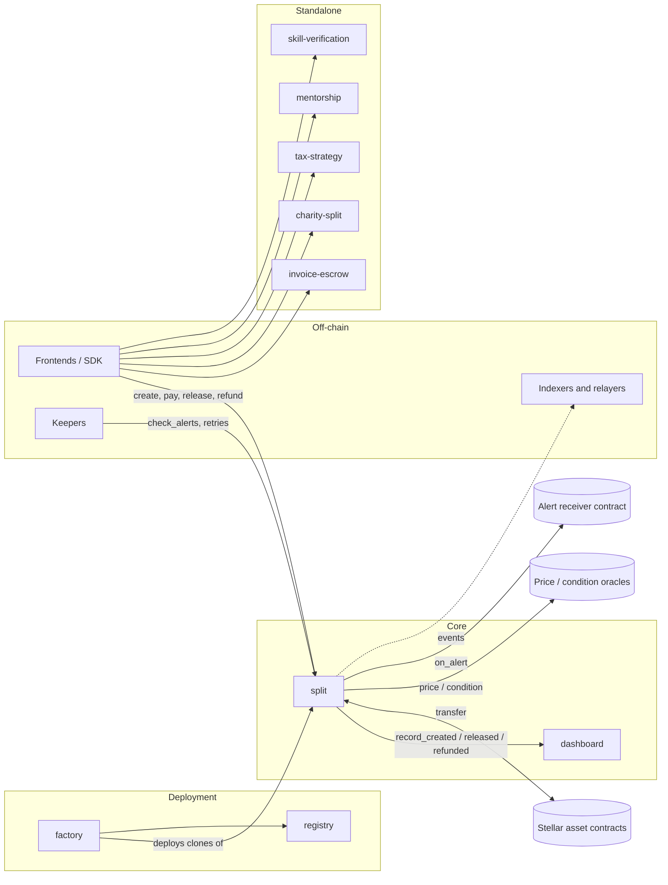
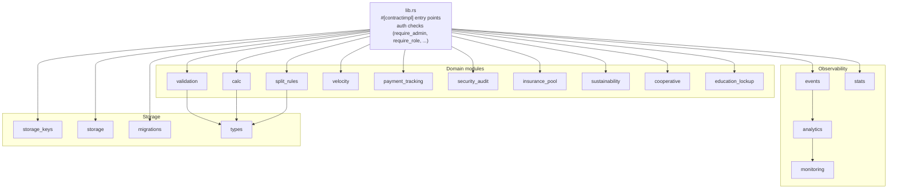
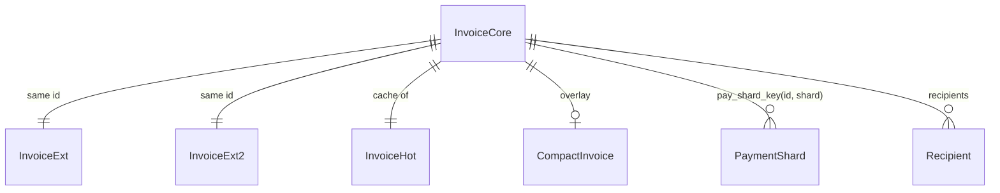
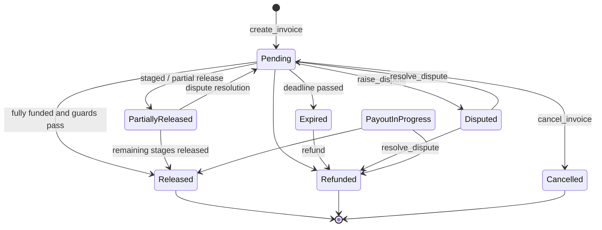
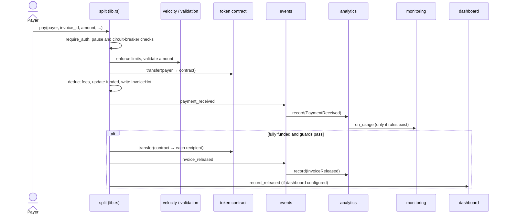
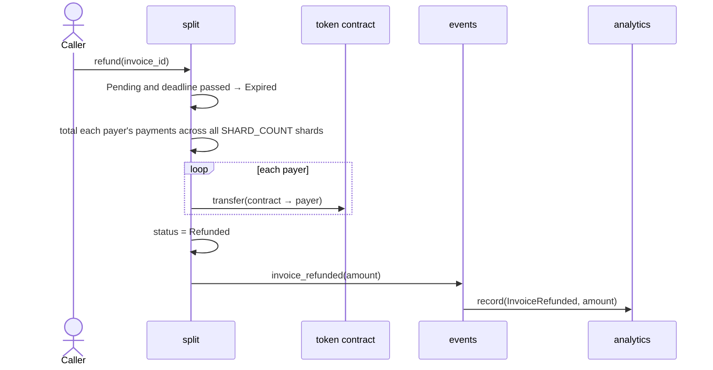
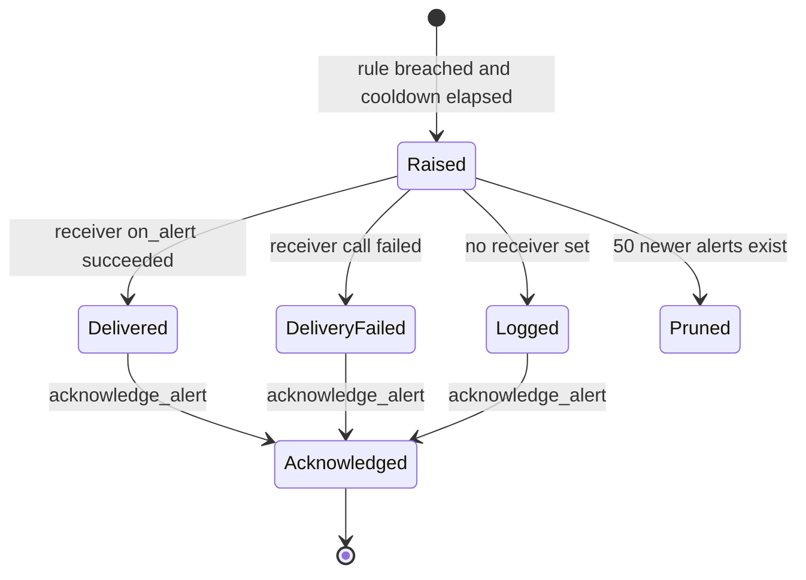

# Contract Architecture

How the StellarSplit Soroban contracts are structured, why they are built this way, and how state
moves through them.

- [1. System map](#1-system-map)
- [2. The `split` contract](#2-the-split-contract)
- [3. Storage model](#3-storage-model)
- [4. State flows](#4-state-flows)
- [5. Cross-cutting concerns](#5-cross-cutting-concerns)
- [6. Design decisions](#6-design-decisions)
- [7. References](#7-references)

Diagrams use [Mermaid](https://mermaid.js.org/), which GitHub renders inline.

---

## 1. System map

The repository is one Cargo workspace (`Cargo.toml`) with nine contract crates. All of them are
`#![no_std]` Soroban contracts built against the workspace `soroban-sdk` version.

| Crate | Path | Role |
|---|---|---|
| `split` | `contracts/split` | Core invoice and payment-splitting contract. Holds most of the protocol logic. |
| `dashboard` | `contracts/dashboard` | Per-creator dashboard counters. Only the authorised `split` contract may write to it. |
| `factory` | `contracts/factory` | Deploys `split` instances as clones of one uploaded WASM blob. |
| `registry` | `contracts/registry` | Index from creator address to the `split` instances they deployed. |
| `invoice-escrow` | `contracts/invoice-escrow` | Stand-alone invoice escrow with its own oracle support. |
| `charity-split` | `contracts/charity-split` | Invoices that donate a share of every payout to a vetted charity. |
| `tax-strategy` | `contracts/tax-strategy` | Creator-configured tax set-asides applied to incoming payments. |
| `mentorship` | `contracts/mentorship` | Creator mentorship program. |
| `skill-verification` | `contracts/skill-verification` | Attestations of recipient skills. |



Tests that span crates live in the top-level `tests/` directory. Fuzz targets live in `fuzz/`.

---

## 2. The `split` contract

### 2.1 Layering

`lib.rs` defines `SplitContract` and every public entry point (about 19,000 lines, grouped into
`#[contractimpl]` blocks by feature and issue number). Logic that can stand alone lives in
modules, and `lib.rs` calls into them after checking authorisation.



### 2.2 Module map

Modules declared in `lib.rs`:

| Module | Purpose |
|---|---|
| `constants` | Shared constants. |
| `error` | `ContractError` codes and recovery suggestions. |
| `types` | `#[contracttype]` structs and enums (invoice records, options, statuses). |
| `events` | Event helpers. Lifecycle helpers also feed `analytics`. |
| `validation` | Invoice input validation (#556, #558). |
| `calc` | Fee and distribution arithmetic. |
| `stats` | Protocol-wide counters (`StatsUpdated`). |
| `security_audit` | Security audit framework (#892). |
| `payment_tracking` | Per-recipient partial payment tracking (#911). |
| `velocity` | Contract-wide payer velocity limits (#912). |
| `split_rules` | Rules engine that computes per-recipient amounts (#913). |
| `analytics` | Usage event tracking, daily aggregates, reports and insights (#1034). |
| `monitoring` | Metrics, alert rules, alert delivery and monitoring stats (#1033). |
| `storage` | Persistent storage helpers with TTL management. |
| `storage_keys` | Central key constructors (#312). |
| `migrations` | Versioned schema checks (`require_schema_current`). |
| `insurance_pool` | Recipient insurance pool governance (#888). |
| `sustainability` | Sustainability impact tracking (#889). |
| `cooperative` | Creator cooperative profit sharing (#890). |
| `education_lockup` | Recipient education funding lock-up (#891). |
| `test`, `fuzz_tests`, `storage_snapshot` | Test-only modules (`#[cfg(test)]`). |

These files are in `src/` but are **not** declared as modules in `lib.rs`, so they are not compiled:
`confidential_tracking.rs`, `creator_fee_tiers.rs`, `factory.rs`, `invoice_metadata.rs`, `math.rs`,
`priority.rs`, `webhooks.rs`. `lib.rs` calls `webhooks::` functions, so wiring that module in is
needed before those paths build.

### 2.3 Entry point groups

The full reference is [`API.md`](./API.md). At a high level:

| Group | Examples |
|---|---|
| Setup and admin | `initialize`, admin roles, timelocked actions, pause, circuit breaker |
| Invoice lifecycle | `create_invoice`, `cancel_invoice`, `delete_invoice`, `pause_invoice`, `resume_invoice` |
| Payment | `pay` and its variants (batched, on-behalf-of, converted, confidential) |
| Release and refund | `release`, partial and staged release, `refund` |
| Disputes | `raise_dispute`, `resolve_dispute` |
| Configuration | velocity limits, split rules, fee waivers and tiers |
| Observability | `get_stats`, `get_usage_*`, alert rules, `check_alerts`, `get_monitoring_dashboard` |

---

## 3. Storage model

### 3.1 Tiers

Soroban has three storage tiers with different rent and eviction behaviour. Tier choice follows
[ADR 0001](./adr/0001-storage-tiers.md).

| Tier | Used for | Examples |
|------|----------|----------|
| `instance` | Contract-level singletons read on most calls | admin, paused flag, token, fee config, circuit breaker, `an_tot`, `mon_rul` |
| `persistent` | Per-entity data that needs long retention | invoice records, payer records, `(an_day, day)`, `(mon_al, id)` |
| `temporary` | Data that can be rebuilt from an authoritative record | derived caches |

Instance keys share the contract's TTL. Persistent keys are bumped on hot-path reads and writes.
The full key list is in [`STORAGE_KEY_REGISTRY.md`](../STORAGE_KEY_REGISTRY.md).

### 3.2 Invoice data model

To stay within Soroban's per-entry size limits, an invoice is split across several keys that
`get_invoice` reads together ([ADR 0004](./adr/0004-split-invoice-records.md)):

```
invoice_key(id)         → InvoiceCore    — creator, recipients, amounts, funded, status, payments, tranches, …
invoice_ext_key(id)     → InvoiceExt     — co-signers, split rules, oracle, penalty, velocity, allowed_payers, …
invoice_ext2_key(id)    → InvoiceExt2    — priorities, refund_grace_secs, scheduled_release_at, …
invoice_hot_key(id)     → InvoiceHot     — { status, funded, total, recipients }, read on every pay() fast path
invoice_compact_key(id) → CompactInvoice — XDR-compressed overlay for read-heavy SDK queries
```

Invoices with many recipients also use per-field keys:

```
recipients_list_key(id)        → Vec<Address>  — recipient addresses
amounts_list_key(id)           → Vec<i128>     — owed amounts
paid_flags_key(id)             → Vec<bool>     — per-recipient paid flags
milestone_flags_key(id)        → Vec<bool>     — per-milestone release flags
compact_status_key(id)         → InvoiceStatus — cached status for fast reads
compact_deadline_ledger_key(id)→ u32           — deadline in ledgers for fast expiry checks
```



### 3.3 Key helpers

| Key function | Parameters | Stores |
|---|---|---|
| `invoice_key` | `id: u64` | `InvoiceCore` |
| `invoice_ext_key` | `id: u64` | `InvoiceExt` |
| `invoice_ext2_key` | `id: u64` | extended fields |
| `invoice_hot_key` | `id: u64` | `InvoiceHot` (fast-path cache) |
| `creator_stats_count_key` | `creator: &Address` | `u64` invoice count |
| `creator_stats_volume_key` | `creator: &Address` | `u64` lifetime volume |
| `creator_stats_released_key` | `creator: &Address` | `u64` lifetime released |
| `vel_key` | `(id, payer)` | `i128` rolling payer velocity |
| `confidential_pay_key` | `(id, payer)` | `ConfidentialPayment` |
| `pay_shard_key` | `(id, shard_index)` | `Payment` shard |

### 3.4 Storage key snapshot

Every storage key is XDR-serialised and compared against a committed baseline in
`tests/snapshots/storage_keys.json` by the `storage_key_snapshot` test. This stops accidental key
renames or format changes from silently breaking on-chain data compatibility.

Adding, renaming or removing a key **intentionally fails the test**. Update the baseline and add a
migration note to the PR.

```bash
# Run the snapshot test
cargo test -p split storage_snapshot

# Update the baseline after an intentional key change
cargo test -p split storage_snapshot 2>&1 \
  | grep -A 9999 "EXPECTED (generated)" \
  | tail -n +2 | head -n -1 \
  > tests/snapshots/storage_keys.json
```

---

## 4. State flows

### 4.1 Invoice status

`InvoiceStatus` is defined in `types.rs`. Allowed moves are enforced by `valid_transition` in
`lib.rs`:



- `Released`, `Refunded`, `Cancelled`, `Finalised` and `Deleted` are terminal. `valid_transition`
  also lists `Expired` as terminal, but `refund()` moves an expired invoice to `Refunded` directly.
- `PayoutInProgress` is an intermediate state while `release_funds` pays recipients (#564).
- `Finalised` is treated as `Released` when checking parent invoices (#522).
- `Deleted` is a soft-delete: a tombstone is kept for the audit trail.
- Same-state transitions are allowed (idempotent).
- Pausing an invoice (`pause_invoice` / `resume_invoice`) blocks payments without changing its status.
- Settled invoices are archived by the internal `archive_invoice_storage` helper once the configured
  archive delay (default `ARCHIVE_AFTER_LEDGERS`) has passed.

### 4.2 Payment and release



### 4.3 Guards on release

`_release` checks these conditions in order before transferring funds:

1. **Circuit breaker**: if active, panics with `ContractPaused`.
2. **Contract pause**: if paused, only exempt addresses proceed.
3. **Status**: must be `Pending`.
4. **Prerequisite**: the referenced invoice must be `Released`.
5. **Co-signers**: must have `required_signatures` approvals.
6. **Oracle condition**: `condition_met` must be `true` if `oracle_address` is set.
7. **Min funding**: `funded * 10_000 / total >= min_funding_bps`.
8. **Tranches**: all tranches must be unlocked by timestamp.
9. **Release stages**: if `release_stages` is set, only the active stage amount is released.
10. **Scheduled release**: `scheduled_release_at` must be in the past.
11. **Release delay**: the `release_delay_ledgers` lock after full funding must have elapsed.

### 4.4 Refund



### 4.5 Fee flow

```
payer sends amount
       │
       ├─► platform_fee = amount * platform_fee_bps / 10_000
       │         (waived if creator is on the fee waiver list)
       │         (reduced if creator qualifies for a fee tier)
       ├─► tax = amount * tax_bps / 10_000  →  tax_authority
       ├─► insurance = amount * insurance_premium_bps / 10_000  →  insurance_fund
       └─► net to invoice funded balance
```

At release:

```
funded balance
       │
       ├─► swap via DEX (if swap_tokens configured per recipient)
       ├─► split by split_rules[] or amounts[]
       └─► transfer to each recipient
```

See [`FEE_FLOW.md`](./FEE_FLOW.md) for details.

### 4.6 Alert lifecycle



---

## 5. Cross-cutting concerns

### 5.1 Authorisation

- `require_admin` loads the admin address, checks the schema version (`migrations`) and calls
  `require_auth`.
- `require_admin_role` and `require_role` gate multi-admin and role-based actions.
- Invoice actions check the creator or co-creators.
- Read-only getters need no auth. `check_alerts` is open to anyone on purpose (keepers).

### 5.2 Events

Events use the topic layout `(symbol_short!("split"), action, invoice_id?)`. The invoice id is left
out for contract-level events. Per-invoice lifecycle events end with an `event_seq` for stable
ordering. The naming rules are at the top of `contracts/split/src/events.rs`.

### 5.3 Observability

| Layer | Source | Read with |
|---|---|---|
| Protocol counters | `stats.rs` | `get_stats` |
| Usage analytics | `analytics.rs`, fed by lifecycle events | `get_usage_dashboard`, `get_usage_report` |
| Monitoring | `monitoring.rs`, fed by analytics | `get_monitoring_dashboard`, `(split, alert, …)` events |
| Per-creator dashboard | `dashboard` crate | `get_creator_dashboard` |

### 5.4 Safety limits

- Loops over contract-wide collections are bounded (for example `MAX_ALERT_RULES`,
  `MAX_REPORT_DAYS`, `MAX_PAYMENT_BATCH_LIMIT`, `MAX_CO_CREATORS`).
- Counters that must never revert a payment saturate instead of failing.
- External calls whose failure must not revert the caller use `try_invoke_contract`.
- Release profile: `overflow-checks = true`, `panic = "abort"`, `opt-level = "z"`.

---

## 6. Design decisions

Decisions are recorded as ADRs in [`docs/adr`](./adr/README.md).

| ADR | Decision |
|---|---|
| [0001](./adr/0001-storage-tiers.md) | Choose the storage tier by access pattern. |
| [0002](./adr/0002-single-contract-with-modules.md) | Keep one `split` contract, with entry points in `lib.rs` and logic in modules. |
| [0003](./adr/0003-observability-from-event-helpers.md) | Record usage analytics from the lifecycle event helpers. |
| [0004](./adr/0004-split-invoice-records.md) | Split invoice records across several keys, with a hot-path cache. |
| [0005](./adr/0005-alert-delivery.md) | Deliver alerts as events plus an optional receiver contract that cannot revert the caller. |

Feature-level design notes are in the `docs/ISSUE_*.md` files.

---

## 7. References

Repository:

- [`API.md`](./API.md): entry point reference
- [`ERROR_CODES.md`](./ERROR_CODES.md): `ContractError` codes
- [`FEE_FLOW.md`](./FEE_FLOW.md): fee calculation
- [`COMPUTE_BUDGETS.md`](./COMPUTE_BUDGETS.md) and [`PERFORMANCE_TUNING.md`](./PERFORMANCE_TUNING.md): cost
- [`STORAGE_KEY_CONVENTIONS.md`](./STORAGE_KEY_CONVENTIONS.md) and [`STORAGE_KEY_REGISTRY.md`](../STORAGE_KEY_REGISTRY.md): storage keys
- [`ISSUE_1034_USAGE_ANALYTICS.md`](./ISSUE_1034_USAGE_ANALYTICS.md) and [`ISSUE_1033_MONITORING_ALERTING.md`](./ISSUE_1033_MONITORING_ALERTING.md): observability
- [`CONTRIBUTING.md`](../CONTRIBUTING.md)

External:

- Soroban documentation: <https://developers.stellar.org/docs/build/smart-contracts>
- Soroban storage and state archival: <https://developers.stellar.org/docs/learn/encyclopedia/storage/state-archival>
- `soroban-sdk` crate docs: <https://docs.rs/soroban-sdk>
- Architecture decision records: <https://adr.github.io/>
- Mermaid syntax: <https://mermaid.js.org/intro/>
