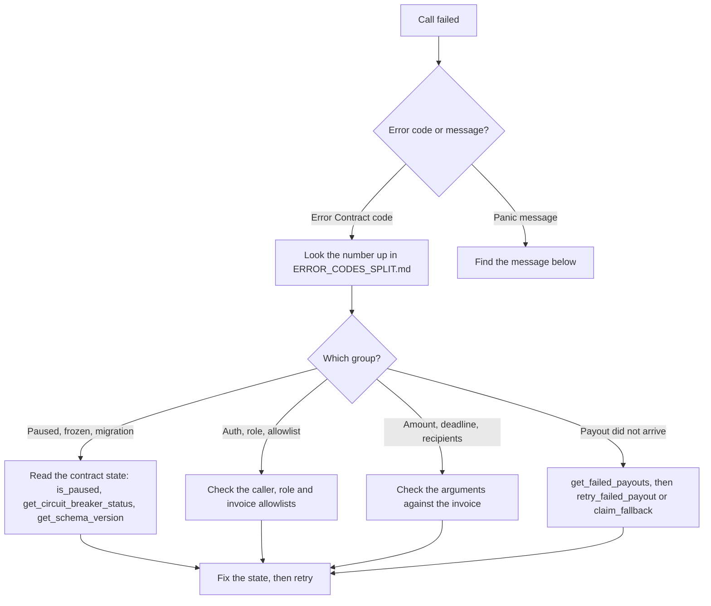

# Troubleshooting guide

Common problems integrators and operators hit when calling these contracts, what causes them in
the actual code, and how to resolve them. For a full code-to-cause table of `invoice-escrow`
error codes, see [`ERROR_CODES.md`](ERROR_CODES.md). For auth/arithmetic/pattern guidance, see
[`SECURITY_BEST_PRACTICES.md`](SECURITY_BEST_PRACTICES.md).

## How to diagnose any failed call

1. Read the returned error code/name, not just "transaction failed." Both `invoice-escrow`
   (`contracts/invoice-escrow/src/errors.rs`) and `split`
   (`contracts/split/src/error.rs`) use `#[contracterror]` enums with **stable, append-only**
   discriminants — the number you get back maps to exactly one documented cause.
2. `invoice-escrow` additionally exposes `get_recovery_suggestion(error: Error) -> String`
   (`contracts/invoice-escrow/src/errors.rs:102`), which returns a human-readable fix for a given
   error code. If you're building a client, call this directly instead of hand-maintaining your
   own copy of the recovery text.
3. Check events, not just the revert. Every mutating entrypoint emits a topic'd event via an
   `emit_*` helper (see `contracts/invoice-escrow/src/lib.rs`); if a call partially succeeded in
   a batch operation (e.g. `refund` with multiple `payers`), the emitted events tell you which
   entries actually went through before a later one reverted the whole call.

## Common issues

### "My deposit/payment keeps failing with `InvalidStatus` / `InvalidStatus` (8/7)"

**Cause:** The invoice is not in a state that allows the operation. `deposit` only accepts
`Pending` or `Active` invoices (`contracts/invoice-escrow/src/lib.rs:836`); once an invoice is
`Released`, `Refunded`, or `Cancelled`, every further deposit/release/refund call on it returns
`InvalidStatus`.

**Fix:** Call `get_invoice(invoice_id)` (or the new `get_compliance_snapshot(invoice_id)`, which
includes the same `status` field alongside approval/dispute context) and confirm the invoice is
still open before retrying. There is no "reopen" path — a resolved invoice is final by design.

### "`release` returns `ApprovalRequired` or `ApprovalRejected`"

**Cause:** Co-signers are configured on this invoice (`set_cosigners` was called) and the
approval tally hasn't reached the threshold (`ApprovalRequired`, code 23) or enough co-signers
rejected that the threshold can no longer be reached (`ApprovalRejected`, code 24) — see
`recompute_approval_status` at `contracts/invoice-escrow/src/lib.rs:189`.

**Fix for `ApprovalRequired`:** Have the remaining co-signers call `approve_release`. Check
`get_approval_status(invoice_id)` to see the live tally.

**Fix for `ApprovalRejected`:** This used to be a dead end — the invoice would sit stuck until
the deadline/refund-grace period passed and someone called `refund`. As of this change, if the
contract admin has called `set_arbiter(arbiter)`, the creator or any co-signer can call
`raise_dispute(caller, invoice_id)` to open a binding dispute, and the configured arbiter can
then call `arbitrate_dispute(arbiter, invoice_id, ForceRelease | ForceRefund, payers)` to break
the deadlock immediately rather than waiting out the deadline. If no arbiter is configured,
`raise_dispute` returns `NoArbiter` (42) — the admin needs to set one first.

### "`refund` returns `DeadlineNotPassed` or `RefundGraceActive`"

**Cause:** Refunds are deliberately not available immediately. `DeadlineNotPassed` (13) means
`env.ledger().timestamp() <= invoice.deadline`. `RefundGraceActive` (38) means the deadline has
passed but the invoice's refund grace window (`contracts/invoice-escrow/src/lib.rs:342-360`)
hasn't elapsed and wasn't waived — this exists to give creators/co-signers/oracles time to clear
release gates before payers are refunded out from under a nearly-complete release.

**Fix:** Wait for the deadline and grace period, check `get_refund_grace_status(invoice_id)` for
the live state, or have the admin call `waive_refund_grace(invoice_id)` if the grace period
should end early. If the block is actually a rejected co-signer vote rather than a genuine
underfunding, consider the arbitration path above instead of waiting out the clock.

### "Payer can't deposit — `PayerBlacklisted`"

**Cause:** The payer has a finalised, upheld blacklist entry (`contracts/invoice-escrow/src/lib.rs:823-831`).
Being blacklisted but *not yet finalised* does **not** block deposits — only `finalised: true` and
`upheld: true` together do.

**Fix:** The payer should call `submit_appeal` within `APPEAL_WINDOW_LEDGERS` of being banned
(`contracts/invoice-escrow/src/lib.rs:120`). If the window already expired
(`AppealWindowExpired`, 16), there is no appeal path left — the admin must call
`finalise_blacklist(payer, uphold: false)` to reinstate them manually.

### "Oracle-gated release fails with `OracleUnavailable` / `OracleStalePrice` / `OracleInvalidPrice`"

**Cause:** `evaluate_oracle_condition` (`contracts/invoice-escrow/src/lib.rs:230`) tries the
primary oracle, and only falls back to `fallback_oracle` (if configured) when the primary fails.
`OracleUnavailable` means neither oracle returned a usable price; `OracleStalePrice` means the
last price is older than `max_staleness_secs`; `OracleInvalidPrice` means the oracle returned a
non-positive price or a future timestamp.

**Fix:** Confirm the oracle contract address is correct and live. If staleness is the issue,
either wait for the oracle to publish a fresh price or raise `max_staleness_secs` via
`set_oracle_condition` (only possible while the invoice is still `Pending`, i.e. before any
deposit) — see `contracts/invoice-escrow/src/lib.rs:1194`.

### "Scheduled release never fires — `ReleaseNotYetDue` / `ScheduleLedgerNotReached`"

**Cause:** `schedule_release` gates release on **both** a Unix timestamp (`release_at`) and a
ledger sequence number (`unlock_ledger`) — see `check_release_gates`,
`contracts/invoice-escrow/src/lib.rs:279`. Both must pass; a fast-closing ledger network can
reach `release_at` well before `unlock_ledger`, or vice versa if ledger close times slow down.

**Fix:** Call `seconds_until_release(invoice_id)` and `ledgers_until_release(invoice_id)` and wait
for both to reach zero before retrying `release`.

### "`split` contract: `NotArbiter` / `NotDisputed`"

**Cause:** The `split` contract (`contracts/split/src/error.rs:27` / `:29`) has its own
dispute/arbitration error taxonomy distinct from `invoice-escrow`'s new arbitration entrypoints.
`NotArbiter` there means the caller isn't the `split` contract's configured arbiter for that
flow; `NotDisputed` means you're calling a dispute-resolution entrypoint on an invoice that isn't
currently under dispute. These are a **different contract's** state — don't confuse a `split`
dispute with an `invoice-escrow` dispute raised via `raise_dispute`; they are tracked separately
even if you're using both contracts in the same product.

### "Admin calls keep failing even though I'm using the admin account"

**Cause:** Almost every admin check in this codebase is `require_admin`
(`contracts/invoice-escrow/src/lib.rs:141`), which calls `.require_auth()` on the address stored
in instance storage — **not** a hardcoded address. If a previous `transfer_admin` /
`accept_admin` handover completed, the "admin account" you're using may no longer be current.

**Fix:** Call `get_admin()` to confirm which address is actually recognized as admin before
debugging further, and check `get_pending_admin()` in case a transfer is stuck mid-handover
(the new admin must call `accept_admin` to complete it; `cancel_transfer` aborts it).

## The `split` contract

Entries for the main `split` contract. Every code below is in [`ERROR_CODES_SPLIT.md`](ERROR_CODES_SPLIT.md).
Some checks fail with a plain panic message and no code, and those are listed by message.

### "Every call fails with `MigrationRequired` (54) after an upgrade"

**Cause:** After a WASM upgrade the stored schema version (`get_schema_version`) is behind the version the
new build expects. Every guarded entry point calls `migrations::require_schema_current` first and panics
until the migration has run.

**Fix:** A SuperAdmin calls `migrate(admin)`. It runs each missing step in order, and is safe to call again if
it stopped part way.

### "`contract is paused`, `ContractPaused` (15) or `function paused`"

**Cause:** The contract is paused (`pause`), one function is paused (`pause_function`), or the circuit
breaker is open. `is_paused` reports the first, `get_circuit_breaker_status` the last.

**Fix:** An admin with the right role unpauses. While the circuit breaker is open, only the functions on
`get_circuit_breaker_exemptions` still run. Status reads such as `is_paused` keep working.

### "`contract is frozen for upgrade` (`ContractFrozen`, 28)"

**Cause:** `freeze_for_upgrade` was called and the contract has not been thawed. `get_upgrade_checkpoint`
returns the checkpoint hash while it is frozen.

**Fix:** A SuperAdmin calls `thaw_contract` once the upgrade work is done.

### "`pay` fails with `invalid nonce`"

**Cause:** The nonce argument must equal the payer's current nonce for that invoice. The first payment uses `0`
and each successful payment adds one.

**Fix:** Read `get_nonce(invoice_id, payer)` and pass that value. Two payments sent at once from the same payer
can collide, so send them one after the other.

### "Creating an invoice fails"

| Error | Cause |
|---|---|
| `InvalidRecipients` (16) | The recipient and amount lists differ in length. |
| `EmptyRecipientList` (37) | No recipients. |
| `BatchLimitExceeded` (18) | More than 200 recipients. `create_batch` with more than five invoices panics with `batch limit exceeded`. |
| `DuplicateRecipient` (55) | The same address appears twice. |
| `ZeroAmountNotAllowed` (41) | An amount is zero or negative. |
| `ArithmeticOverflow` (40) | The total is above `MAX_INVOICE_TOTAL`. |
| `DeadlinePassed` (3) | The deadline is not after the current ledger time. |
| `InvalidDeadline` (78) | The deadline is more than ten years ahead. |
| `InvalidRatioSum` (36) | Split ratios do not add up to 10,000 bps. |
| `TooFewRecipients` (66) | Fewer recipients than the minimum set with `set_min_recipients`, see `get_min_recipients`. |

### "A payer is refused: `PayerNotAllowed` (8), `ContributorNotAllowed` (42) or `UnauthorisedToken` (43)"

**Cause:** The invoice has an allowed-payer list or a contributor allowlist that does not include the payer, or
the token is not on the contract's allowed token list (`get_allowed_tokens`).

**Fix:** The creator adds the payer (`add_allowed_payer`, `add_contributor_to_allowlist`), or an admin allows the
token with `add_allowed_token`.

### "`DuplicatePayment` (29) or `RateLimitExceeded` (25)"

**Cause:** The same payment was repeated inside the duplicate window (`get_duplicate_window_ledgers`), or the
caller used the creation or payment rate limit.

**Fix:** Do not resend a payment that already went through. Check the invoice with `get_invoice_funded` first.
For the rate limit, wait for the window to reset.

### "A recipient was not paid at release"

**Cause:** The transfer to that recipient failed, for example they have no trustline for the token
(`RecipientMissingTrustline`, 51) or no account (`RecipientAccountMissing`, 61). The release continues with the
other recipients and records the failure.

**Fix:** Read `get_failed_payouts(invoice_id)`. Once the recipient has fixed their account, call
`retry_failed_payout(invoice_id, recipient)`, or the recipient calls `claim_fallback`. A payout recorded as pending
after release is collected with `claim_pending_payout`.

### "`reveal_payment` fails with `CommitmentExpired`, `CommitmentMismatch` or `ActiveCommitmentExists`"

**Cause:** Commit-reveal payments have two steps. `ActiveCommitmentExists` means the payer already has a
commitment on this invoice. `CommitmentExpired` means too many ledgers passed (`set_commitment_expiry`).
`CommitmentMismatch` means the revealed amount and salt do not hash to the stored commitment.

**Fix:** Reveal with exactly the amount and salt used to build the commitment and before it expires. If it has
expired, commit again.

### "My test fails"

See [`INTEGRATION_TESTING.md`](INTEGRATION_TESTING.md). The usual causes are a missing `initialize`, a ledger
time that was never set, a payer that was not minted tokens, and a stale storage snapshot.

## FAQ

**Q: Why do I get a numeric error code instead of a message from the simulated transaction?**
Soroban contract errors are `#[contracterror]` enums, which cross the host/guest boundary as
plain `u32` discriminants — there is no room for a dynamic string in the error itself. Use
`error_from_code(code)` (`contracts/invoice-escrow/src/errors.rs:272`) to map the number back to
the `Error` variant, then `get_recovery_suggestion` for the human-readable text.

**Q: Can I reuse an error code number for a new error?**
No. Every error enum in this repo is commented "Discriminants are stable — never reorder, only
append" (e.g. `contracts/invoice-escrow/src/errors.rs:3`, `contracts/split/src/error.rs:3`).
Off-chain indexers and clients key behavior off these numbers; reusing one silently breaks them.

**Q: My call works in a test but fails on a live/testnet deployment — why?**
Check whether the failing call depends on `env.ledger().timestamp()` or
`env.ledger().sequence()` — tests typically control these values directly, while a live network
advances them at its own pace. Deadline, grace-period, and schedule-related errors
(`DeadlinePassed`, `RefundGraceActive`, `ReleaseNotYetDue`, `ScheduleLedgerNotReached`) are the
usual culprits; re-check the actual current ledger time/sequence against the invoice's stored
values via `get_invoice` / `get_release_schedule` / `get_refund_grace`.

**Q: A co-signer vote seems "stuck" and I can't change it.**
Votes can be withdrawn with `revoke_vote`, but only while the invoice is still open
(`contracts/invoice-escrow/src/lib.rs:1142`) — once `release`/`refund`/`cancel_invoice` has
executed, the vote history is permanent, matching the invoice's own terminal status.

## Still stuck?

Open an issue with: the exact entrypoint called, the arguments (redact secrets/keys), the
returned error code or panic message, and the output of `get_invoice` /
`get_compliance_snapshot` for the affected invoice ID. That snapshot alone resolves most "what
state is this invoice actually in" questions without needing several follow-up queries.
